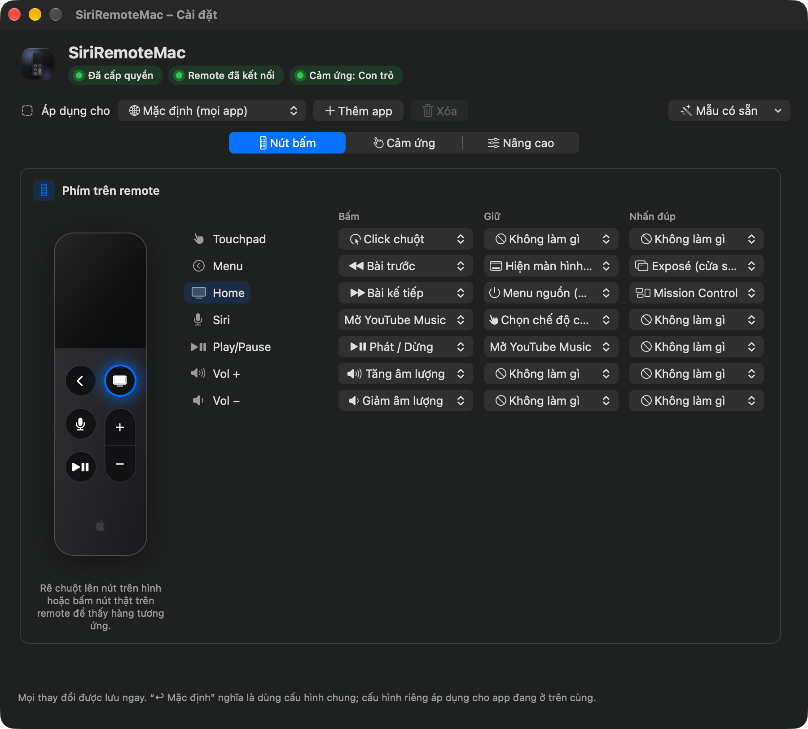
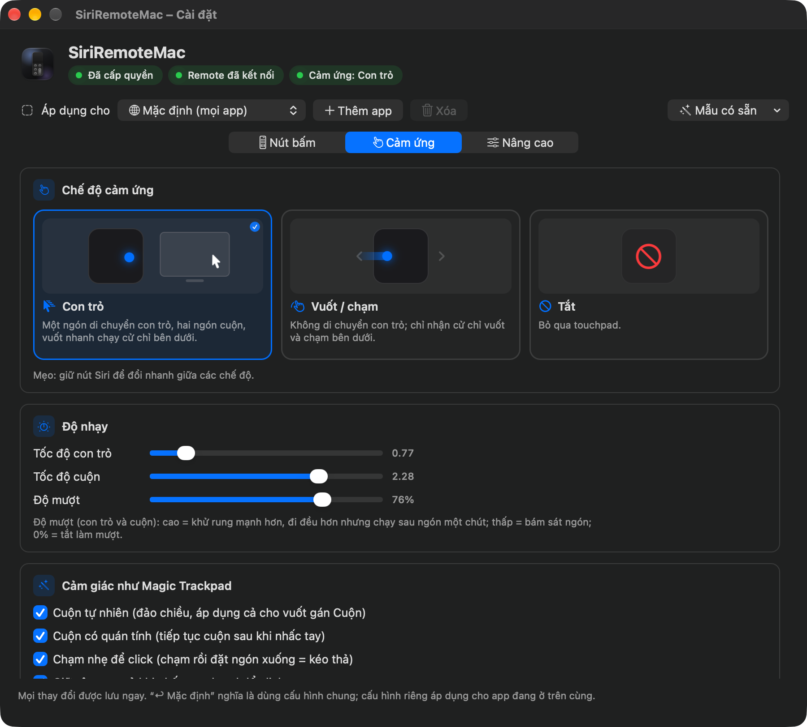
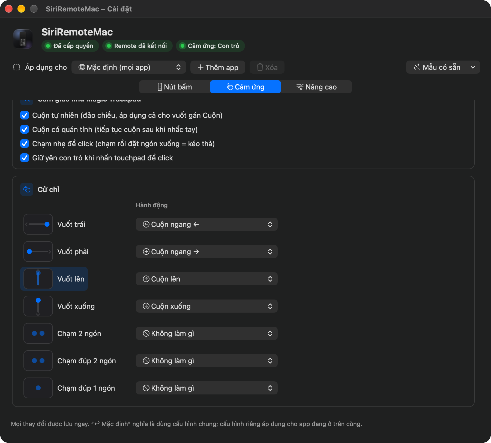
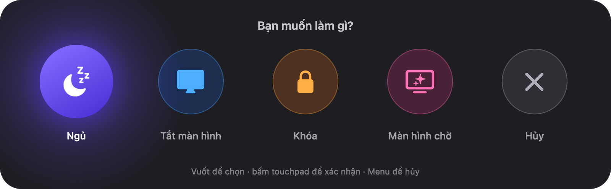
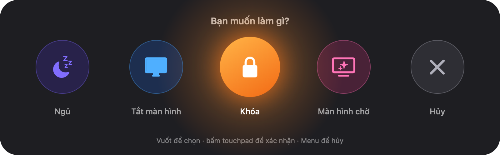
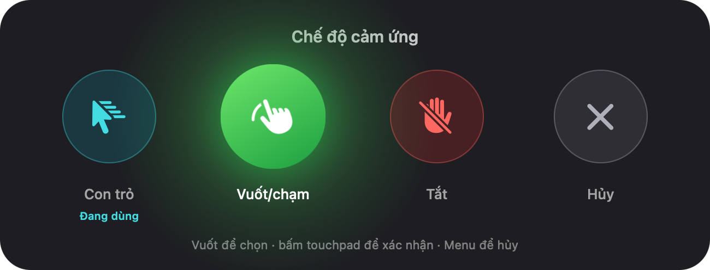
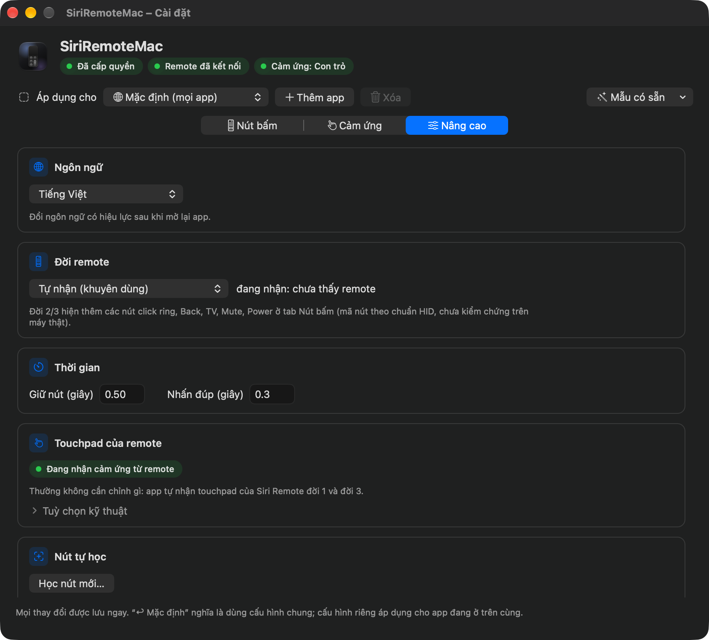

# SiriRemoteMac

Ứng dụng thanh menu cho macOS, biến **Apple TV Siri Remote** (ghép Bluetooth) thành bộ điều khiển Mac: chuyển bài, phát/dừng, âm lượng, mở app, di chuột và cuộn bằng touchpad như Magic Trackpad, menu nguồn kiểu Apple TV…

<p align="center"></p>

**Tính năng chính**
- Gán hành động cho từng nút: **bấm / giữ / nhấn đúp**, chung cho mọi app hoặc **riêng từng app** (Safari, YouTube, Keynote…).
- **Touchpad như Magic Trackpad:** di chuột có gia tốc, cuộn hai ngón có quán tính, khóa trục, khử rung; vuốt 4 hướng, chạm 2 ngón, chạm đúp, **zoom thông minh**.
- **Menu nguồn kiểu Apple TV** (giữ Home) và **bảng chọn chế độ cảm ứng** (giữ Siri), điều khiển hoàn toàn bằng remote.
- Cửa sổ cài đặt có **hình minh hoạ remote** sáng lên khi bạn bấm nút thật, mẫu cấu hình có sẵn, tiếng Việt / English.

> Đã thử với Siri Remote đời 1 (A1513, product ID `0x266`). Đời 2/3 có hỗ trợ nhưng mã một số nút chưa kiểm chứng trên máy thật (xem [Dùng với các đời Siri Remote khác](#dùng-với-các-đời-siri-remote-khác)).

## Mục lục
- [Cài đặt](#cài-đặt)
- [Hướng dẫn sử dụng](#hướng-dẫn-sử-dụng)
- [Cảm ứng touchpad](#cảm-ứng-touchpad)
- [Dùng với các đời Siri Remote khác](#dùng-với-các-đời-siri-remote-khác)
- [Cấu hình bằng file JSON](#cấu-hình-bằng-file-json)
- [Menu trên thanh menu](#menu-trên-thanh-menu)
- [Xử lý sự cố](#xử-lý-sự-cố)
- [Giới hạn](#giới-hạn)
- [Dành cho nhà phát triển](#dành-cho-nhà-phát-triển)
- [Ngôn ngữ / Language](#ngôn-ngữ--language)

## Cài đặt

Yêu cầu: macOS 13 trở lên, Xcode Command Line Tools (`xcode-select --install`).

```
chmod +x build_app.sh
./build_app.sh
```
Script tạo `SiriRemoteMac.app` và `SiriRemoteMac.dmg`. Kéo app vào **Applications** và mở từ đó.

### Ký app để macOS nhớ quyền (khuyên làm một lần)
Mặc định app được ký ad-hoc, nên mỗi lần build lại macOS sẽ hỏi lại quyền. Để giữ quyền qua các lần build, tạo chứng chỉ cục bộ:
1. Keychain Access → Certificate Assistant → **Create a Certificate…**
2. Name: `SiriRemoteMac Local`, Identity Type: **Self Signed Root**, Certificate Type: **Code Signing**.

`build_app.sh` tự dùng chứng chỉ này nếu có (đổi tên bằng biến `SIGN_IDENTITY`).

### Quyền cần cấp
System Settings → Privacy & Security: bật **Accessibility** và **Input Monitoring** cho `SiriRemoteMac.app`, rồi thoát và mở lại app. Nếu thiếu Accessibility, các phím do app phát ra sẽ bị macOS bỏ qua; cửa sổ Cài đặt hiện nhãn cam *Thiếu quyền Accessibility* kèm nút **Cấp quyền…**.

### Ghép remote
Tắt Apple TV (hoặc rút nguồn) để remote không tự nối lại với nó. Vào System Settings → Bluetooth, giữ **Menu + Volume Up** khoảng 5 giây rồi bấm Connect.

### Khởi động cùng macOS
Biểu tượng remote trên thanh menu → **Khởi động cùng macOS** (chỉ khi chạy từ `.app`).

## Hướng dẫn sử dụng

### 1. Mở Cài đặt
Bấm biểu tượng remote trên thanh menu → **Cài đặt…** (⌘,). Đầu cửa sổ có ba nhãn trạng thái, tự cập nhật mỗi giây:

| Nhãn | Xanh | Cam |
|---|---|---|
| Quyền | Đã cấp quyền Accessibility | Thiếu quyền → bấm **Cấp quyền…** |
| Remote | Đã kết nối | Chưa kết nối: bấm một nút bất kỳ để đánh thức remote, hoặc ghép lại |
| Cảm ứng | Đang dùng chế độ *Con trỏ* / *Vuốt/chạm* | Cảm ứng đang tắt |

Mọi thay đổi được **lưu ngay** vào `~/.siriremote.json`, không cần bấm Lưu.

### 2. Gán hành động cho nút (tab Nút bấm)
<p align="center"></p>

- Mỗi nút có ba cột: **Bấm**, **Giữ** (mặc định giữ 0,8 giây, chỉnh ở tab Nâng cao), **Nhấn đúp**. Bấm vào ô để chọn hành động: media, phím, chuột, zoom, hệ thống, *Mở ứng dụng…* hoặc *Phím tắt…* tự nhập.
- **Hình remote bên trái:** rê chuột lên một nút trên hình thì hàng tương ứng sáng lên (và ngược lại). **Bấm nút thật trên remote** thì nút trên hình nảy lên kèm gợn sóng, tiện để biết nút nào là nút nào.
- **Mẫu có sẵn** (góc phải): áp dụng nhanh bộ cấu hình *Nghe nhạc*, *Xem YouTube*, *Lướt TikTok*, *Duyệt web*, *Thuyết trình*.
- **Cấu hình riêng cho từng app:** ở ô *Áp dụng cho*, bấm **＋ Thêm app** (chọn app đang chạy hoặc từ thư mục Applications). Khi app đó ở trên cùng, các nút được đặt riêng sẽ thay cho mặc định; ô để *↩ Mặc định* vẫn dùng cấu hình chung. Ví dụ: Keynote dùng ← → chuyển slide, Safari dùng Menu/Home để Back/Forward.

### 3. Chế độ cảm ứng và độ nhạy (tab Cảm ứng)
<p align="center"></p>

- **Chế độ cảm ứng:** bấm vào thẻ để chọn. Mỗi thẻ có hình động minh hoạ cách dùng.
  - **Con trỏ:** một ngón di chuột, hai ngón cuộn, vuốt nhanh chạy cử chỉ.
  - **Vuốt / chạm:** không di chuột, chỉ nhận cử chỉ vuốt và chạm.
  - **Tắt:** bỏ qua touchpad.
- **Độ nhạy:** *Tốc độ con trỏ*, *Tốc độ cuộn*, và **Độ mượt**. Độ mượt cao thì con trỏ và trang đi đều hơn nhưng chạy sau ngón một chút; thấp thì bám sát ngón hơn; 0% là tắt làm mượt. Mặc định 55%.
- **Cảm giác như Magic Trackpad:** cuộn tự nhiên, cuộn có quán tính, chạm nhẹ để click, giữ yên con trỏ khi nhấn để click.

### 4. Cử chỉ
Kéo xuống cuối tab Cảm ứng. Mỗi cử chỉ có một touchpad mini minh hoạ; rê chuột vào hàng để xem cử chỉ chuyển động, và khi bạn làm cử chỉ thật trên remote thì viền touchpad mini nháy sáng.

<p align="center"></p>

| Cử chỉ | Khóa | Gợi ý |
|---|---|---|
| Vuốt trái / phải / lên / xuống | `swipeleft`, `swiperight`, `swipeup`, `swipedown` | Cuộn, chuyển bài, Back/Forward |
| Chạm 2 ngón | `twofingertap` | Click phải (mặc định) |
| Chạm đúp 2 ngón | `twofingerdoubletap` | Zoom thông minh |
| Chạm đúp 1 ngón | `doubletap` | Zoom thông minh, Phát/Dừng |

Vuốt gán *Cuộn* sẽ trôi mượt có quán tính, quãng cuộn tỉ lệ với tốc độ vuốt, và theo chiều *Cuộn tự nhiên*.

### 5. Menu nguồn (giữ Home)
Giữ **Home** mở bảng chọn giữa màn hình thay vì cho Mac ngủ ngay (tránh lỡ tay):

<p align="center"></p>

- **Vuốt trái/phải** trên touchpad (hoặc ←/→ trên click ring, hoặc **bấm Siri** để xoay vòng) để chuyển ô; ô đang chọn sáng màu và phóng to:

<p align="center"></p>

- **Bấm touchpad** hoặc **Play/Pause** để chọn; **Menu**, **Back** hoặc **Home** để hủy. Bảng tự đóng sau 10 giây không thao tác. Bấm chuột trực tiếp cũng được.
- Trong lúc bảng mở, con trỏ và cử chỉ tạm dừng; nút âm lượng vẫn hoạt động.

### 6. Đổi chế độ cảm ứng (giữ Siri)
Giữ **Siri** mở bảng chọn chế độ cảm ứng. Chế độ đang dùng có nhãn *Đang dùng*; tiêu điểm đặt sẵn ở chế độ hay đổi sang (Con trỏ ↔ Vuốt/chạm), nên **giữ Siri rồi bấm touchpad** là đổi qua lại nhanh. Khi cảm ứng đang tắt, bấm Siri để chuyển ô.

<p align="center"></p>

### 7. Tab Nâng cao
<p align="center"></p>

Ngôn ngữ, đời remote, thời gian giữ / nhấn đúp, trạng thái touchpad của remote (mã thiết bị nằm trong *Tuỳ chọn kỹ thuật*), học nút mới, và tinh chỉnh hiệu ứng Back/Forward. Tab này chỉ hiện khi chọn *Mặc định (mọi app)*.

## Cảm ứng touchpad

App đọc cảm ứng qua framework riêng `MultitouchSupport` của Apple (cách mà HyperVibe, Remote Buddy… dùng). Không cần quyền thêm ngoài Accessibility.

**Giống Magic Trackpad**
- **Di chuột mượt:** touchpad remote gửi dữ liệu đều mỗi 15 ms (66,7 Hz), lệch nhịp với màn hình 60 Hz nên con trỏ từng nhảy gấp đôi vài lần mỗi giây. App vẽ con trỏ theo từng khung hình (nội suy, trễ khoảng 20 ms) và lọc rung toạ độ (bộ lọc One Euro); đo trên bản ghi thật, độ giật giảm từ khoảng 29 % xuống khoảng 9 %.
- **Gia tốc con trỏ:** chậm = chính xác, nhanh = đi xa; chỉnh bằng *Tốc độ con trỏ*.
- **Cuộn hai ngón:** xuất sự kiện cuộn đều theo khung hình, **khóa trục** (cuộn dọc không trôi ngang), gia tốc, **quán tính** chậm dần như trackpad thật (khóa `scrollmomentum`); chạm lại để dừng.
- **Click trúng đích:** khi nhấn touchpad, app lấy lại vị trí con trỏ ngay trước lúc nhấn và bỏ qua rung nhẹ cho tới khi bạn thật sự kéo (khóa `clicksteady`).
- **Chạm nhẹ để click** (khóa `tapclick`); chạm rồi đặt ngón xuống lại ngay và kéo để kéo thả.
- **Zoom thông minh** (`smartzoom`): như chạm đúp hai ngón trên Magic Trackpad: Safari, Preview, Chrome… phóng vừa khối nội dung dưới con trỏ, làm lại thì về cũ.
- Không làm được: Force Click, chụm để zoom, vuốt 3 ngón (remote không gửi lực nhấn và bề mặt quá nhỏ).

**Vuốt ở chế độ Con trỏ:** nếu một hướng vuốt đã được gán hành động, con trỏ đứng yên trong lúc app chờ xem có phải cú vuốt không; đi chậm (dưới tốc độ của một cú vuốt) thì con trỏ được nhả ngay sau 0,1 giây.

**Chạm đúp 1 ngón:** khi đã gán `doubletap`, chạm một lần sẽ click chậm khoảng 0,3 giây (chờ xem có lần chạm thứ hai) và tạm tắt "chạm rồi giữ để kéo".

**Safari:** có sẵn cấu hình riêng (thêm một lần, sửa/xóa tùy ý): Menu = Back (`cmd+[`), Home = Forward (`cmd+]`). Hành động thử nghiệm `nav:back` / `nav:forward` giả lập cú vuốt hai ngón để có hiệu ứng trượt trang; cần bật *Vuốt giữa các trang* trong System Settings → Trackpad → More Gestures.

**Không thấy phản hồi cảm ứng?** Xem tab Nâng cao → *Touchpad của remote*. Nếu báo chưa nhận được touchpad: bật **Ghi log nút bấm**, tắt/bật remote, mở file log và xem các dòng `MT thiết bị #… family=…`, rồi thêm `family` đó vào *Tuỳ chọn kỹ thuật → Mã thiết bị cảm ứng* (khóa `touchfamily`; mặc định `160,145`). Đây là API riêng của Apple nên có thể đổi giữa các bản macOS.

## Dùng với các đời Siri Remote khác

Cài đặt → tab **Nâng cao** (chỉ khi chọn *Mặc định (mọi app)*):
- **Đời remote:** để *Tự nhận* (theo product ID: `0x266` = đời 1) hoặc chọn tay. Đời 2/3 hiện thêm các nút click ring (giữa/↑/↓/←/→), Back, TV, Mute, Power ở tab *Nút bấm*, và hình minh hoạ đổi sang remote nhôm bạc. Mã HID các nút này **theo chuẩn Consumer Control, chưa kiểm chứng trên máy thật**.
- **Học nút mới…:** bấm nút trên remote để app ghi nhận mã và đặt tên; dùng khi nút chưa có hoặc mã mặc định không đúng. Lưu trong khóa `custombuttons`.
- **Mã thiết bị cảm ứng:** đời 1 = `160`, đời 3 = `145` (luôn thử cả hai).

## Cấu hình bằng file JSON

File `~/.siriremote.json` (tự tạo lần chạy đầu). Dùng **tên nút** làm khóa:

```json
{
  "menu": "media:previous",
  "menu+hold": "showdesktop",
  "home": "media:next",
  "home+hold": "powermenu",
  "siri": "app:YouTube Music",
  "siri+hold": "touchmenu",
  "touchpad": "click",
  "playpause": "media:playpause",
  "swipeup": "scroll:up",
  "swipedown": "scroll:down",
  "twofingertap": "rightclick",
  "twofingerdoubletap": "smartzoom",
  "holdtime": "0.7",
  "doubletime": "0.3"
}
```

**Tên nút:** `menu`, `home`, `siri`, `touchpad`, `playpause`, `volup`, `voldown`; đời 2/3 thêm `select`, `up`, `down`, `left`, `right`, `back`, `tv`, `mute`, `power`. Vẫn dùng được mã HID dạng `"0C:0060"`.

**Cử chỉ:** `swipeleft`, `swiperight`, `swipeup`, `swipedown`, `twofingertap`, `twofingerdoubletap`, `doubletap`.

**Hậu tố:** `+hold` (giữ nút), `+double` (nhấn đúp).

**Hành động**

| Hành động | Ý nghĩa |
|---|---|
| `key:cmd+shift+4`, `key:right`, `key:space` | Phát phím tắt |
| `media:playpause`, `next`, `previous`, `volumeup`, `volumedown`, `mute`, `fast`, `rewind` | Phím media. Giữ nút với `fast`/`rewind` sẽ tua liên tục |
| `scroll:up`, `scroll:down`, `scroll:left`, `scroll:right` | Cuộn mượt có quán tính (giữ nút để cuộn liên tục) |
| `nav:back`, `nav:forward` | Back/Forward kèm hiệu ứng trượt trang (thử nghiệm) |
| `app:Tên App` | Mở ứng dụng |
| `click`, `rightclick` | Click chuột trái / phải |
| `powermenu` | Menu nguồn như Apple TV (mặc định khi giữ Home) |
| `touchmenu` | Bảng chọn chế độ cảm ứng (mặc định khi giữ Siri) |
| `toggletouch` | Đổi thẳng Con trỏ ↔ Vuốt/chạm, không qua bảng |
| `sleep`, `displaysleep` | Cho Mac ngủ / tắt màn hình |
| `lockscreen`, `screensaver` | Khóa màn hình (⌃⌘Q) / bật màn hình chờ |
| `smartzoom` | Zoom thông minh như chạm đúp hai ngón trên Magic Trackpad |
| `zoomtoggle` | Zoom nhanh: lần đầu phóng to 3 mức (⌘=), lần sau về kích thước thật (⌘0) |
| `zoomin`, `zoomout`, `zoomreset` | ⌘+, ⌘−, ⌘0 |
| `mission`, `expose`, `showdesktop` | Mission Control, Exposé (cửa sổ của app đang dùng), hiện màn hình nền |
| `none` | Tắt hành động mặc định của nút |

**Tùy chọn**

| Khóa | Ý nghĩa | Mặc định |
|---|---|---|
| `holdtime`, `doubletime` | Thời gian giữ / khoảng nhấn đúp (giây) | `0.8`, `0.3` |
| `touchmode` | `cursor` / `swipe` / `off` | `cursor` |
| `touchspeed`, `scrollspeed` | Tốc độ con trỏ / cuộn | `1.5`, `1.0` |
| `scrollsmooth` | Độ mượt con trỏ và cuộn, `0`–`1` | `0.55` |
| `naturalscroll`, `scrollmomentum`, `tapclick`, `clicksteady` | `1` bật / `0` tắt | `1`, `1`, `0`, `1` |
| `touchfamily` | Mã thiết bị cảm ứng, cách nhau dấu phẩy | `160,145` |
| `remotemodel` | `auto` / `gen1` / `gen23` | `auto` |
| `navduration`, `navdistance`, `navinvert` | Tinh chỉnh hiệu ứng `nav:back` / `nav:forward` | `0.25`, `0.9`, `0` |
| `language` | `auto` / `vi` / `en` | `auto` |

Cấu hình riêng cho từng app nằm trong khóa `apps` (khóa con là bundle id của app; dùng `none` để tắt một nút trong app đó):

```json
{
  "home": "media:next",
  "apps": {
    "com.apple.iWork.Keynote": { "home": "key:right", "menu": "key:left" }
  }
}
```

Cấu hình của bạn được **gộp** lên mặc định; dùng `"none"` để tắt một nút mặc định. Sau khi sửa tay, chọn **Nạp lại cấu hình** trong menu trên thanh menu.

## Menu trên thanh menu
- **Cài đặt…** (⌘,), **Chế độ cảm ứng**, **Khởi động cùng macOS**
- **Nâng cao:** *Chiếm quyền remote* (chỉ bật khi gán lại Vol/Play, tránh macOS xử lý trùng), *Ghi log nút bấm* (ghi `~/Library/Logs/SiriRemoteMac.log` để dò mã nút, cử chỉ và kiểm tra quyền), mở file cấu hình, nạp lại cấu hình, mở file log
- **Thoát**

## Xử lý sự cố
- **Nút bấm không có tác dụng:** xem nhãn quyền ở đầu cửa sổ Cài đặt. Bật *Ghi log nút bấm* và xem dòng `RUN ... accessibility=true/false`.
- **Remote chưa kết nối:** bấm một nút để đánh thức remote; nếu vẫn không, ghép lại (giữ Menu + Volume Up).
- **Con trỏ / trang chạy theo sau ngón:** hạ *Độ mượt* (tab Cảm ứng). Còn giật thì tăng lên.
- **Cử chỉ chạm không nhận:** bật *Ghi log nút bấm*, thử lại và tìm dòng `CỬ CHỈ ...` trong log.
- **Quyền hỏi lại sau mỗi lần build:** tạo chứng chỉ ký như ở phần Cài đặt.
- **Lỗi `detritus not allowed` khi ký:** script đã xóa thuộc tính mở rộng (`xattr -cr`); nếu vẫn lỗi, chép thư mục ra nơi không đồng bộ iCloud.
- **Phím media không chuyển bài / không tua:** trình duyệt (ví dụ YouTube) thường chỉ nhận Play/Pause/Next/Previous, không nhận tua.
- **Play/Pause không phát lại sau khi dừng:** thường do macOS/app nhạc mất quyền nhận phím media; thử bằng phím F8 trên bàn phím.
- Không chạy cùng Remote Buddy hoặc SiriMote (tranh quyền với remote).

## Giới hạn
- **Tọa độ cảm ứng không có trong báo cáo HID** của remote; app đọc qua `MultitouchSupport`, là API riêng của Apple nên có thể đổi giữa các bản macOS. Chưa kiểm thử trên mọi đời remote.
- **Mic trên remote** không được macOS nhận như thiết bị âm thanh.
- Không có Force Click, chụm để zoom, vuốt 3 ngón.

## Dành cho nhà phát triển

```
Sources/
  main.swift, AppDelegate.swift   khởi động, menu trên thanh menu, quyền
  Controller.swift                đọc nút HID, giữ / nhấn đúp, chuyển nút cho bảng chọn
  Touch.swift                     cảm ứng MultitouchSupport: con trỏ, cuộn, cử chỉ, lọc One Euro
  CursorPump.swift                di chuột theo khung hình (nội suy theo dấu thời gian touchpad)
  ScrollPump.swift                cuộn theo khung hình, quán tính, cú hất
  Action.swift                    các hành động (phím, media, zoom thông minh…)
  ChoiceMenu.swift                bảng chọn kiểu Apple TV (menu nguồn, chế độ cảm ứng)
  Settings.swift                  cửa sổ Cài đặt
  Illustrations.swift             hình minh hoạ và animation (Core Animation)
  Config.swift, Localization.swift
build_app.sh                      đóng gói .app và .dmg
icon/                             icon app (SVG + PNG 1024)
docs/images/                      ảnh chụp cho README
tools/                            công cụ nghiên cứu sự kiện
```

- `SiriRemoteMac.app/Contents/MacOS/SiriRemoteMac --settings`: mở thẳng cửa sổ Cài đặt.
- `SiriRemoteMac.app/Contents/MacOS/SiriRemoteMac --screenshots docs/images`: chụp lại toàn bộ ảnh trong README rồi thoát (chụp cửa sổ của chính app, không cần quyền ghi màn hình). Thoát bản đang chạy trước, và bấm một nút trên remote để nhãn trạng thái hiện *Remote đã kết nối*.
- Công cụ trong `tools/` (cần quyền Input Monitoring cho Terminal):
  - `Sniffer.swift`: nghe gói HID của remote (`swiftc -O tools/Sniffer.swift -o sniffer && ./sniffer | tee sniffer.log`).
  - `ScrollSniffer.swift`: ghi mọi trường của sự kiện cuộn, để so cú vuốt trackpad thật với cú vuốt giả lập.
  - `GestureSniffer.swift`: ghi các sự kiện cử chỉ (zoom thông minh, phóng to…).

## Ngôn ngữ / Language

Giao diện hỗ trợ **tiếng Việt** và **English**. Mặc định tự theo ngôn ngữ hệ thống (tiếng Việt → Việt, còn lại → English); đổi trong Cài đặt → Nâng cao → Ngôn ngữ (hoặc khóa `"language": "auto" | "vi" | "en"` trong `~/.siriremote.json`) rồi mở lại app.

The UI is available in Vietnamese and English. It follows the system language by default; change it in Settings → Advanced → Language (or `"language": "auto" | "vi" | "en"` in `~/.siriremote.json`) and restart the app.
